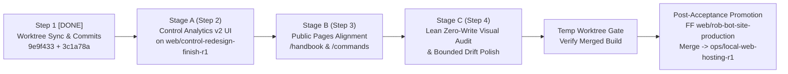

# Critical Path: Website Improvements (Analytics v2, Public Pages Alignment, and Live Visual Audit)

Date: 2026-11-20
Status: Finalized after GPT-6.2 Sol High Critiques #1 and #2 (scope trimmed for lean execution)
Authoritative design contract: `docs/superpowers/specs/2026-10-16-control-design-system.md`
Prior delivery record: `docs/superpowers/decisions/2026-10-21-control-redesign-finish.md`
Local hosting contract: `docs/superpowers/specs/2026-10-16-local-control-runtime.md`

## Context and Current Baseline

The Discord bot on `main` (`26fbbbc`) has completed Stages 0 through 6 plus Hardened Message Logs and is actively writing `schema_version: 2` analytics snapshots into `/Users/aedwon/Documents/Projects/marwie-server-bot/data/marwie.db` (`control_guild_snapshots`).

**Step 1 (Worktree Commit & Sync) is already complete:**
- `web/control-redesign-finish-r1` and local `web/rob-bot-site-production` are clean at `9e9f433` (`feat(control): add rail hover expansion and navigation motion`, 1 commit ahead of `origin/web/rob-bot-site-production`; 306 web tests passing).
- `ops/local-web-hosting-r1` is clean at `3c1a78a` (`8510569` local SQLite UTC normalization + HTTP 202 guild-state refresh, plus merge of `9e9f433`, 3 commits ahead of `origin/ops/local-web-hosting-r1`; 328 web tests passing, `npm run check:web` passing, `git diff --check` clean).
- Neither branch has been pushed to remote.

**Live runtime caveat:**
- `server/local-server.js` streams `docs-site/` files directly from disk, so static HTML/CSS/JS edits serve immediately once integrated into `ops/local-web-hosting-r1`.
- The currently running `com.aedwon.marwie-server-web` Node process predates `8510569`, so its ESM cache still holds the pre-`8510569` `api/guild-state.js` and `api/_lib/sqlite-database.js` modules. `/healthz` checks HTTP availability only and does not prove newly merged API modules are loaded; reloading Node API code requires an explicit operator-approved LaunchAgent restart plus runtime verification.

## Operating Principles

1. **Plan file reconciliation and acceptance-first promotion:**
   - During planning, these four plan files sit untracked in `/Users/aedwon/Documents/Projects/marwie-server-bot-wt-local-web-hosting-r1/docs/superpowers/plans/` for user review.
   - At execution start (before Stage A), **move** (not copy-and-leave) these four files out of `wt-local-web-hosting-r1` into `/Users/aedwon/Documents/Projects/marwie-server-bot-wt-control-redesign-finish-r1/docs/superpowers/plans/` and commit them on `web/control-redesign-finish-r1` using explicit named paths (never `git add -A`). That prevents untracked-file merge collisions later when merging into `ops/local-web-hosting-r1`.
   - Implement Stage A, Stage B, and Stage C polish strictly on `web/control-redesign-finish-r1`.
   - Do **not** move local `web/rob-bot-site-production` or merge into live `ops/local-web-hosting-r1` until:
     1. Stage C visual acceptance passes with 0 remaining contract failures;
     2. Fast-forward ancestry is verified (`git merge-base --is-ancestor web/rob-bot-site-production web/control-redesign-finish-r1`);
     3. An isolated temporary detached worktree merging `web/control-redesign-finish-r1` onto `ops/local-web-hosting-r1` passes `TZ=Asia/Manila npm run check:web`, `TZ=Asia/Manila npm run test:web`, and `git diff --check` (verifying integrated local-refresh + UI compatibility BEFORE modifying the served checkout).
   - Never touch `main`, `src/`, `migrations/`, `tests/`, or `com.aedwon.marwie-server-bot`. Never push without explicit user approval.
2. **Zero-write production SQLite discipline:**
   - Never write to `/Users/aedwon/Documents/Projects/marwie-server-bot/data/marwie.db`.
   - Because live `/api/session` writes `last_seen_at` (`api/_lib/control.js:175`) and stale `/api/guild-state` can enqueue `refresh_snapshot` (`api/guild-state.js:87`), Stage C runs an isolated loopback review server reusing `server/local-server.js` `createLocalServer({ siteRoot, apiLoaders })` against a single read-only JSON snapshot read into memory from `marwie.db` (`{ readOnly: true, readBigInts: true }`, closed immediately before listening).
   - Post-promotion live smoke on `127.0.0.1:8787` stays strictly read-only (`/healthz`, unauthenticated `/`, `/commands`, `/handbook`, `/styles.css`, `/api/session`).
3. **Routing contract preserved verbatim:**
   - `/` and `/control` and `/control/*` serve `docs-site/control.html`.
   - `/handbook` serves `docs-site/index.html`.
   - `/commands` serves `docs-site/commands.html`.
   - `/styles.css` remains served with HTTP 200 (`web-tests/local-server.test.js:46`).
4. **Design-system and decision discipline:**
   - `docs/superpowers/specs/2026-10-16-control-design-system.md` is authoritative: paper/ink/sky tokens (`#fcfcfb`/`#ffffff`/`#111113`/`#2f6fa3`/`#7db9e8` light; `#0f0f11`/`#19191c`/`#ececee`/`#7db9e8` dark), Figtree `400`/`500`/`600` (zero `650`/`700`), `12px` metadata floor (`13px` routine UI floor and `13px`/`18px` Commands metadata contract), System theme default with full light/dark parity, WCAG 2.2 AA contrast, tabular numerals, and `prefers-reduced-motion` support.
   - Record all deliberate reversals before editing code in `docs/superpowers/decisions/2026-11-20-website-public-and-analytics-alignment.md`:
     1. Local-time Analytics display (supersedes R3 forced-UTC X-axis in `2026-09-01-control-uiux-refinements-r3.md:59`).
     2. Eight-field v2 operational activity total (`tickets_reopened` and `anonymous_messages` added alongside the 6 R3 fields; `quiz_correct` kept out of totals; v1 buckets stay identical to 6 fields).
     3. `/commands` System theme default (supersedes dark-first default in `2026-08-30-all-commands-redesign.md:28`).
     4. Isolated zero-write review-server visual acceptance (supersedes direct live-origin OAuth capture in `2026-10-21-control-redesign-finish.md` so automated audit never writes to production `marwie.db`).
5. **Visual Companion First (kept lean):**
   - Before editing UI code in Stage A or Stage B, render one concise inline mockup via `html_preview` + `html_render` (light, dark, and mobile) as a visual proposal and confirm clarity before coding.
6. **TDD and coordinated cache-busting:**
   - RED -> GREEN -> full verification (`TZ=Asia/Manila npm run check:web`, `TZ=Asia/Manila npm run test:web`, `git diff --check`).
   - Bump `?v=` on every edited CSS/JS asset across HTML entrypoints, ESM imports, and pinned tests (`control-theme-surfaces.test.js`, `control-legacy-removal.test.js`, `control-stage3-reconciliation.test.js`). Keep `./control-theme.js` and `./control-navigation.js` unedited and unversioned (pinned in `commands-redesign.test.js:71-72`).

## Dependency Graph

## Asset Version Allocation Plan

Baseline at `9e9f433`:
- `control.css?v=31`, `control-features.css?v=15`, `control-app.js?v=29`, `control-analytics.js?v=20`
- `styles.css?v=14`, `home.css?v=2`, `visual.css?v=1`, `app.js?v=17`
- `commands.css?v=7`, `commands.js?v=7`

Planned sequential bumps (only for files edited in each stage):
- **Stage A:** `control.css?v=32`, `control-features.css?v=16`, `control-app.js?v=30`, `control-analytics.js?v=21` (syncing `control.html`, `commands.html`, `control-app.js`, and pinned tests).
- **Stage B:** `styles.css?v=15`, `home.css?v=3`, `visual.css?v=2`, `app.js?v=18`, `commands.css?v=8`, `commands.js?v=8` (removing `/styles.css` from `commands.html`; keeping `commands.html` on `control.css?v=32`).
- **Stage C:** Bump only assets touched by confirmed drift fixes by `+1` and sync their pinned tests before promotion.

## Stage Sequence (Trimmed Scope)

### Step 1: Commit and Sync Live Web Changes
- **Status:** `[x]` Completed (`9e9f433` on `web/control-redesign-finish-r1` & local `web/rob-bot-site-production`; `8510569` + merge `3c1a78a` on `ops/local-web-hosting-r1`).

### Stage A (Step 2): Upgrade Control Analytics Page (`/control/analytics`) for v2 Analytics
- **Plan:** `docs/superpowers/plans/2026-11-20-stage-a-analytics-v2-ui.md`
- **Lean scope:** Surface v2 metrics (`open_ticket_backlog` labeled point-in-time, `ticket_median_close_seconds`, `tickets_reopened`, `tickets_closed` with distinct count when different, `anonymous_messages`, passive `human_messages` & `voice_member_minutes` with exact `Unavailable`/`(partial)`/measured semantics), per-range `coverage` chips (`business_events`, `messages`, `voice`), local-time formatting (handling DST and cross-year labels), and one operational-events SVG chart with accessible focusable/tappable points and a non-clipping bucket breakdown inspector outside the chart scroller. Keep flat and unversioned ranged v1 snapshots backward-compatible. **Deferred (YAGNI):** multi-series passive chart switcher (passive telemetry is currently disabled in production; bucket breakdown already shows passive counts whenever non-null).

### Stage B (Step 3): Align Public Pages (`/handbook` and `/commands`) with Control Design System
- **Plan:** `docs/superpowers/plans/2026-11-20-stage-b-public-pages-alignment.md`
- **Lean scope:**
  - `/commands`: drop `/styles.css`, load Figtree `400;500;600`, switch default to System, migrate `commands.css` onto canonical Control tokens (400/500/600 weights, `>= 13px`), fix the broken desktop-`inert` drawer bug, align drawer breakpoint to `< 876px` (keeping `>= 600px` workspace), and stop drawer Escape from clearing active search.
  - `/handbook`: load Figtree `400;500;600`, migrate `styles.css`/`home.css`/`visual.css` off `#365544` green and SF Pro onto canonical paper/ink/sky tokens (400/500/600 weights, `>= 12px`, consistent `visual.css` cascade), fix `app.js` theme persistence and mobile drawer `inert`/focus handling, and remove stale `"45 slash commands"` wording. Keep Handbook markup/nav structure otherwise unchanged.

### Stage C (Step 4): Lean Live Visual Audit, Bounded Polish, and Safe Promotion
- **Plan:** `docs/superpowers/plans/2026-11-20-stage-c-live-visual-audit.md`
- **Lean scope:** Launch a small zero-write review server reusing `server/local-server.js` with a read-only snapshot from `marwie.db` to inspect the representative signed-in Control routes (including Analytics v2 and empty/signed-out states) plus `/commands` and `/handbook` at `1440x900` light & dark, `1024x900` light, `960x900` light (context drawer below `1016px`), and `390x844` light & dark. Fix only confirmed Design System or accessibility defects via TDD, validate the merged candidate in a temp worktree before moving refs, then promote cleanly and run exact read-only live checks on `127.0.0.1:8787`.

## Explicitly Out of Scope (Anti-Scope-Creep Guardrails)

- No multi-series passive chart switcher until passive telemetry is actually enabled in production.
- No Handbook navigation overhaul, new Handbook sections, or copy rewrites beyond removing the stale `"45 slash commands"` count.
- No edits to `main`, `src/`, `migrations/`, `tests/`, `pyproject.toml`, or any Python code.
- No edits to `docs/commands.md` or `docs-site/commands.md` (keep the 43-command manual parity intact).
- No restarting `com.aedwon.marwie-server-bot`, no writes to `marwie.db`, no new npm dependencies, no routing or OAuth/CSRF changes, and no `git push` without explicit user approval.
